<div align="center">

# ReclaimYourNet

**Report once. File everywhere. Prove it happened.**

*A TinyFish web agent that turns one description of online harm into every report
you need to file - on the right portals, with the right evidence, and with proof
that you actually filed them.*


</div>

---

## The problem

Reporting online harm is a **bureaucratic job**, and victims are the worst
equipped people in the world to do it.

You're scared and do not know where to go for help and nobody seems to have just the right answer, that is where ReclaimYourNet slides in!

1. **Knowing where to file.** A platform report, a cybercrime portal complaint, a
   bank dispute and a police FIR are four different routes to four different
   outcomes. Skip the wrong one and you lose the outcome you needed.
2. **Knowing what each form wants.** Every portal asks for a different subset of
   facts and a different set of evidence.
3. **Keeping up with the fact that things move.** Portals change, forms change,
   helplines change. Any list hard-coded into an app goes stale - silently.
4. **Proving you reported it.** Banks and police ask for reference numbers.
   Most victims never get them, or never keep them.
5. **The part everyone skips: the harm is not over when you hit send.** Content
   reappears, gets morphed with AI, gets re-uploaded to a different site, and
   gets indexed by a search engine so strangers can find it in seconds.

> One impersonation account using a student's photo turned out to need **seven
> actions across five organisations**: a platform report, a cybercrime portal
> complaint, a bank dispute, a police FIR, a Google URL removal, and a
> pre-emptive hash registration with a takedown service. No single place would
> have told the victim to do all seven.

## The solution

**ReclaimYourNet turns one description into a filed, evidenced, monitored case. It all runs locally so you wouldn't need to worry about any information getting uploaded to the cloud**

| # | Stage | Who does it |
| --- | --- | --- |
| 1 | **Describe** - one free-text or spoken description | Victim |
| 2 | **Triage** - a local, explainable model labels the harm, extracts entities and masks sensitive values | ReclaimYourNet (offline ML) |
| 3 | **Plan** - labels become a prioritised set of routes, each with a reason and a deadline. If we know the city, it also finds **that city's** police station and **that state's** Commission - a FIR can only be registered locally | ReclaimYourNet (rules + ML) |
| 4 | **Discover** - a web agent searches the live web for the *current* official portal for each route | **TinyFish Search** |
| 5 | **Read** - the agent opens the real page and reads the form it actually has today | **TinyFish Web Agent** |
| 6 | **Review** - the victim sees every value that will be typed, with sensitive fields masked | Victim |
| 7 | **File** - the agent types the approved values, stops, and submits only on a second explicit approval | **TinyFish Web Agent** |
| 8 | **Prove** - every page read, reference number and submission goes into a SHA-256 hash chain, exportable as a case-file PDF | ReclaimYourNet |
| 9 | **Follow up** - monitors re-check the reported URL and tell you whether the content actually came down | **TinyFish Monitor** |

**The design principle: nothing about the world is hard-coded.** The channel
catalogue in the code is only a *fallback*. The real channel graph - which
portal, which URL, which fields, which evidence - is resolved **live, per case,
at the moment of the report**.

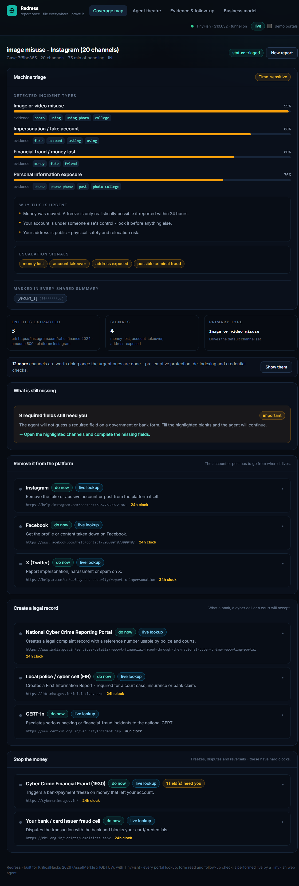

*One sentence in, and the agent has already found the real reporting pages -
`help.instagram.com`, `i4c.mha.gov.in`, `cert-in.org.in`, `rbi.org.in` - each
with the reason it applies, the clock on it, and an honest note about what you
are still missing.*

---

## TinyFish integration (the mandatory part)

We use four TinyFish surfaces, each for a job a static implementation cannot do.

| Surface | Where | What it replaces |
| --- | --- | --- |
| **Search API** | `apps/api/src/pipeline/orchestrator.ts` &rarr; `discoverChannels()` | A hard-coded list of portal URLs that goes stale. At report time the agent asks the live web where the current official reporting page is, per country, and scores results for officialness (`.gov`, `.nic.in`, known platform domains). **Give it a city and the query becomes city-specific** - type *Gurugram* and the agent finds `gurgaon.haryanapolice.gov.in/cyber-crime` (the district's own cyber crime page) instead of a generic national portal. |
| **Web Agent (SSE)** | `orchestrator.ts` &rarr; `analyseChannel()` / `fileChannel()` | A hard-coded form schema. The agent opens the real page and returns the **actual** fields, labels, required flags, dropdown options and evidence requests through `output_schema`; then types the approved values and submits. The `PROGRESS` and `STREAMING_URL` SSE events are streamed straight into the user's browser as a **live view of the agent working**. |
| **Fetch API** | evidence capture | Downloading a page to attach to the case file. Also the substrate of the Page Monitor. |
| **Monitor API** | `orchestrator.ts` &rarr; `armMonitors()` | "We filed it and hoped." A Page Monitor re-checks the reported URL every 6 hours; a Topic Monitor watches for a **clone** of the impersonation account appearing somewhere new. |

**Where the agent is deliberately _not_ used:** triage and redaction of personal
data. Those stay local, deterministic and auditable.

**Cost discipline.** Search and Fetch are free within TinyFish's daily
allowance; the Agent is metered per step ($0.016). ReclaimYourNet therefore reads each
form once and caches the field spec, splits filing into "fill" and "submit" so
a human approval sits between them, and never runs an agent the user did not
ask for.

**How a judge can verify this in 30 seconds:** the app has a **Practice mode**
toggle. The real report forms on Instagram, X and the banks all ask you to log
in, so a cloud agent cannot fill them - in practice mode the agent drives a
bundled clone of each form instead. Same agent, same goal, same structured
output, same live preview. The agent really runs; only the target changes. Turn it
off and you get the live portal discovery instead.

---

## The machine learning

Two very different jobs, deliberately split.

### Triage (local, explainable, offline) - `packages/core`

* **Model:** one-vs-rest L2-regularised **logistic regression** over a TF-IDF
  vector of unigrams + bigrams, from a synonym-folded, stemmed token stream.
  14 incident types, 223 hand-labelled multi-label examples, trained with
  full-batch gradient descent + momentum.
* **Why not an LLM?** Triage must be reproducible, offline, free and able to
  justify itself. A victim is being asked to trust a recommendation that tells
  them to report to a government portal - "because the word *scammer*
  contributed +2.1 to fraud" is a sentence a human can check.
* **Evaluation** (stratified 5-fold CV, `npm run eval`):

  | Metric | Value |
  | --- | --- |
  | Macro F1 | 0.62 |
  | Macro precision | 0.50 |
  | Macro recall | 0.83 |
  | Top-1 label correct | 89.7% |

  The numbers are honest and reproducible from the committed corpus. We
  over-predict labels on purpose: in this domain a **missed label means a missed
  reporting route**, and an extra channel is cheap while a missing one is not.

* **Explainability is a feature.** The model stores a weight per token, so the
  UI shows the exact words that drove each label (`money +2.1`, `scam +1.8`,
  `photo +1.4`).
* **Hard-signal rules layer on top** - money lost, threat, minor involved,
  intimate content, identity exposed, account takeover - each with its own
  confidence floor, so a weak co-label never triggers a "call the police now"
  banner.

### The agentic half (live web) - TinyFish

Which portal, which form, what evidence, and *is it still true right now* - the
parts an LLM cannot do and a hard-coded list does badly.

---

## Architecture

```
 browser (React 19 + Vite + Tailwind)
   |  POST /api/cases        -> explainable triage (local ML, in the API)
   |  POST /api/action       -> ONE request per agent run, streamed back:
   |     { action, case }      the case travels with the request, and the run's
   |                           events + result come back on one connection
   v
 API (Fastify 5, Node 20+, TypeScript)
   |- @reclaim/core   classifier, taxonomy, planner, redaction   (no network)
   |- pipeline        discover -> analyse -> review -> file -> monitor
   |- evidence        SHA-256 hash chain + PDFKit case file
   |- store           in-memory only. A report is never written to disk.
   v
 TinyFish
   |- Search   live portal + helpline discovery
   |- Agent    read the live form, fill it, submit it  (SSE + output_schema)
   |- Fetch    evidence snapshots
   |- Monitor  follow-up checks on the reported URL
```

**Three decisions that matter:**

1. **The model decides *what* this is; the agent decides *what to do* on the
   actual web; the human decides *what gets submitted*.** No layer can submit
   anything on its own.
2. **One request per agent run, streamed back.** A serverless platform gives
   every request a fresh instance with no memory of the last one - so the case
   travels with the request, and the run, the live browser preview and the
   result all travel on one connection.
3. **Nothing is persisted.** No account, no user database, no analytics, no
   tracking. A report lives in the memory of the app and dies with the tab.

---

## How it works, screen by screen

A first-time visitor should never be confused, and every statement on the page
should have an action attached to it. Here is the flow, in order.

### 1. The question box (the first screen)

One box: **"What happened?"** Type or dictate one sentence, press
**Find where to report this**, or tap one of the three example chips. "Add my
details" opens name / email / mobile / city, and the hint under each field says
*either this or your mobile - one is enough*.

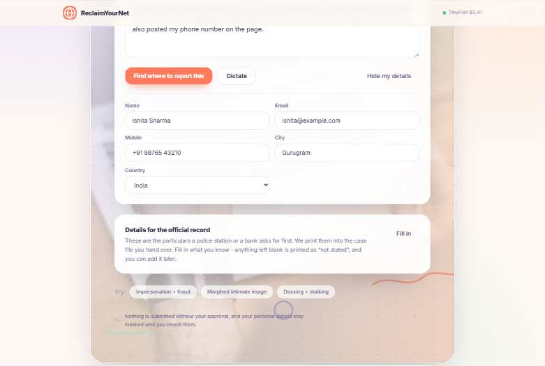

### 2. The particulars for the official record

The second card on the same screen asks what a police station asks for first:
when it happened, where, which account did it, how much money, and whether it
is still going on. It is optional, it only goes into the case file, and the
agent reads it to fill the forms. Leave it blank and it is printed as *not
stated*.

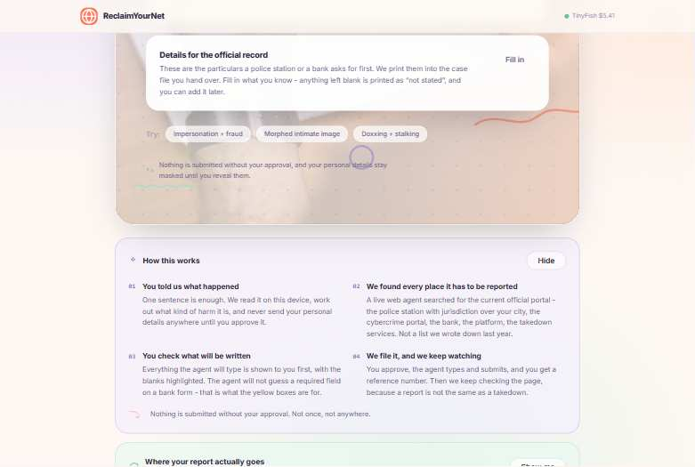

### 3. "How this works"

Four plain steps, one click to open, so a first-time visitor always knows where
they are.

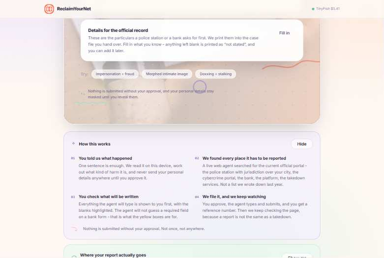

### 4. Triage and the urgency banner

A local model labels the incident and the page says what that means in a
sentence, not a score: *"Money was moved. A freeze is only realistically possible
if reported within 24 hours."*

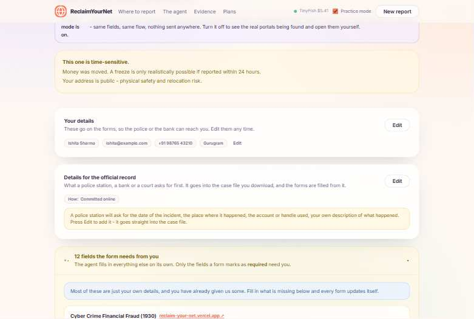

### 5. Your details

Editable at any point. Change your name or number and every form below is
rebuilt with the new values - and anything you typed by hand is kept.

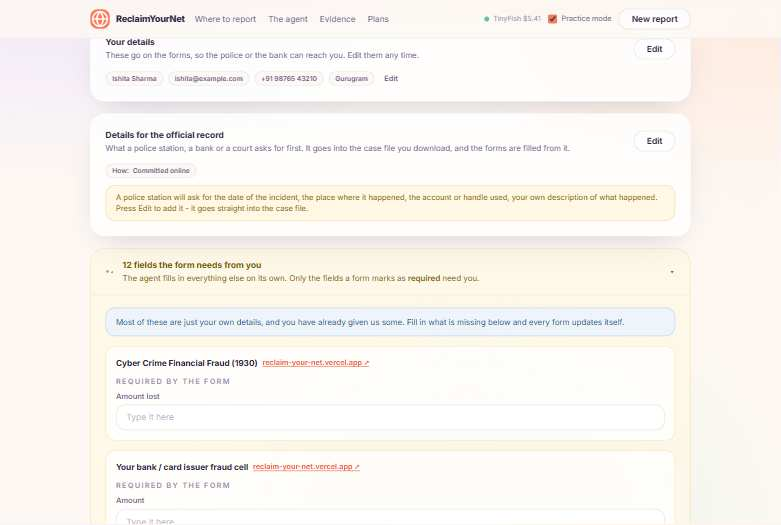

### 6. The panel that only asks for what is required

A collapsible panel. The agent fills in everything it can; only fields a form
marks as **required** need you. Contact fields are grouped - **"Email or mobile:
either one is enough"** - and optional fields are labelled optional, so nobody
fills them in.

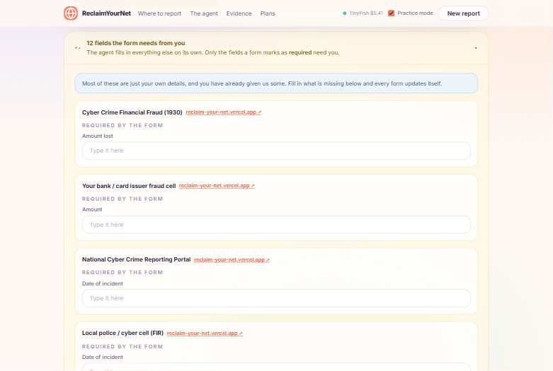

### 7. The coverage map

Every place it has to be reported, in numbered groups: remove it from the
platform, create a legal record, stop the money, take it down before it spreads,
shrink the blast radius. Each row has the reason it applies, the clock on it, the
live link, and its own action.

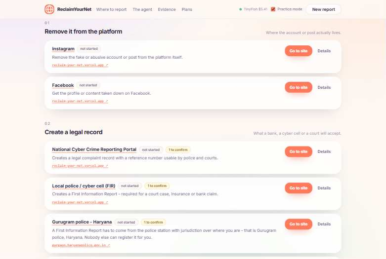

### 8. One channel, opened

Every value the agent will type is shown before anything is submitted - the
complainant's name, the date, the amount, the account, and the narrative it
wrote. Nothing reaches the portal until you approve it.

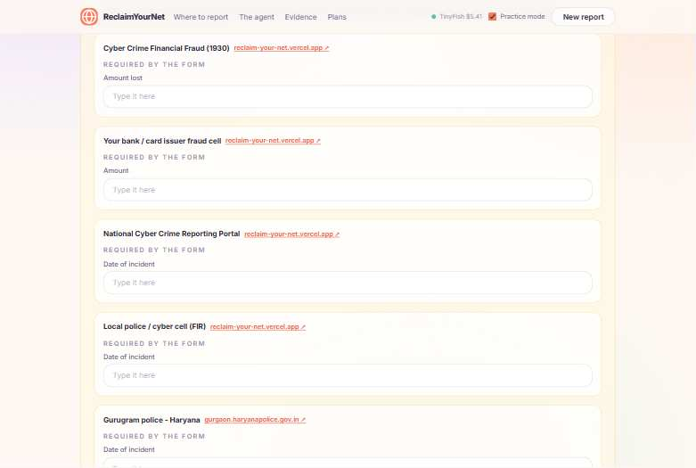

### 9. The agent

Press **Read the form** and a TinyFish agent opens the real page in a cloud
browser and returns the fields it has *today*. You watch it in the live
preview, or open it full size. The agent then fills the form and stops before
Submit.

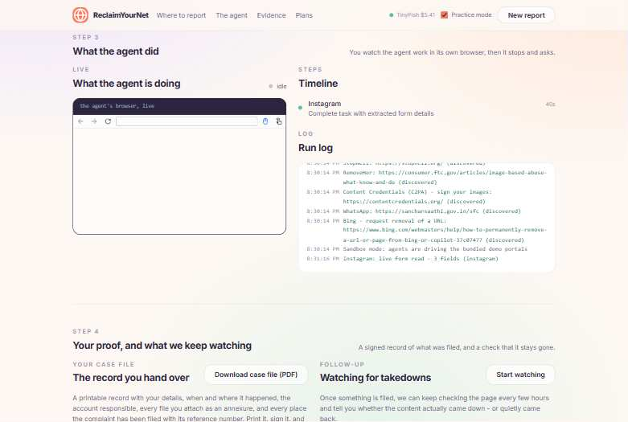

### 10. "Filled 3 of 3"

You do not have to take it on trust. The card shows a green badge with the count
and the agent's own summary, field by field. If something genuinely required is
missing, the badge is amber and names it.

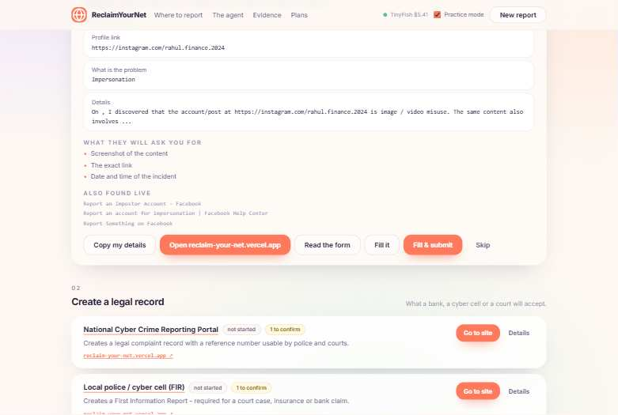

### 11. Your case file, and what we keep watching

The case file is a document, not a screenshot of a product: your particulars,
when and where it happened, the account responsible, every file you attach as
an annexure, every place the complaint was filed with its reference number, and
a declaration to sign. Attach your own screenshots and videos under it - they
are hashed, printed as annexures, and the images are reproduced in the PDF
itself. Then a TinyFish Monitor re-checks the reported page every six hours -
because a report is not the same as a takedown.

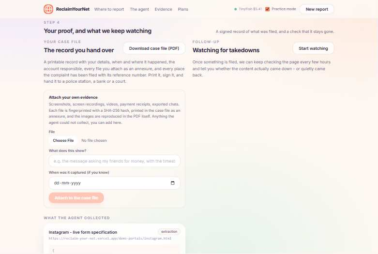

**A timed 2m30s run with the script is in [`docs/DEMO.md`](docs/DEMO.md).**

---

## Quick start

```bash
git clone <your-fork> ReclaimYourNet && cd ReclaimYourNet
npm install
cp .env.example .env      # add your TINYFISH_API_KEY
npm run dev               # API on :4000, web on :5173
```

Open <http://localhost:5173>.

### Practice mode (recommended for the demo)

The TinyFish browser runs in the cloud, so it cannot reach `localhost`. Start a
public tunnel and put the URL in `.env`:

```bash
npx cloudflared tunnel --url http://localhost:4000
# -> copy the https://xxx.trycloudflare.com URL into PUBLIC_BASE_URL in .env
npm run dev
```

Flip the **Practice mode** toggle in the app header and the agent will drive the
bundled clone of each form instead of the real site. Deterministic, fast, and
impossible to break on a flaky venue wifi.

### Deploy to Vercel

The repo is Vercel-ready as-is (`vercel.json`, `api/[...path].ts`):

```bash
npx vercel --prod
vercel env add TINYFISH_API_KEY production
```

The deployment URL is detected automatically from the request, so the deployed
app can drive its own demo forms and the agent can reach them. A live
deployment is at **https://reclaim-your-net.vercel.app**.

### Other commands

```bash
npm test        # 11 unit tests for the triage engine
npm run eval    # reproducible 5-fold cross-validation of the classifier
npm run build   # core -> api -> web
npm start       # serve the built app from the API
python scripts/build_pptx.py   # regenerate the submission .pptx from docs/PPT.md
```

---

## Repository map

```
packages/core/                the triage engine (no network, no dependencies)
  src/ml/classifier.ts        one-vs-rest logistic regression
  src/ml/dataset.ts           223 hand-labelled multi-label examples
  src/ml/tokenize.ts          synonym folding + stemming
  src/ml/redact.ts            privacy-by-default PII masking
  src/ml/entities.ts          amount / platform / URL / phone / date extraction
  src/triage.ts               triage + urgency + hard-signal rules
  src/planner.ts              labels -> prioritised channels, deadlines, gaps
  src/taxonomy.ts             incident types, platforms, authorities, protections
  scripts/eval-classifier.ts  the evaluation table in this README
apps/api/                     Fastify API
  src/tinyfish/client.ts      Search / Fetch / Agent(SSE) / Monitor / Wallet
  src/pipeline/orchestrator.ts  discover -> analyse -> file -> monitor
  src/casereport/pdf.ts       the case-file PDF
  src/routes.ts               /api/action - one streamed route for every action
  demo-portals/               clones of the real forms, for practice mode
apps/web/                     React + Vite + Tailwind client
  src/components/Intake.tsx       the question box
  src/components/HowItWorks.tsx   the four-step guide
  src/components/YourDetails.tsx   editable name / email / mobile / city
  src/components/MissingFields.tsx the collapsible "only what is required" panel
  src/components/CoverageMap.tsx  the places to report, ranked
  src/components/AgentTheatre.tsx the live browser + timeline + log
  src/components/EvidenceVault.tsx the hash chain + the case file + monitors
  src/components/Privacy.tsx      where your report actually goes
api/[...path].ts              Vercel serverless entry
scripts/build_pptx.py          builds the submission .pptx from docs/PPT.md
docs/PPT.md                   the judge-facing pitch deck
docs/PLAN.md                  what was built, and why
docs/DEMO.md                  the timed demo script
docs/DEVTO_POST.md            the social media post
```

---

## Safety and ethics

- **Human in the loop, twice.** Approval before the agent types, and a separate
  approval before it submits.
- **No invention.** The agent is instructed to leave a field empty and report
  it rather than guess. ReclaimYourNet surfaces those gaps to the user instead of
  hiding them.
- **Privacy by default.** Addresses, ID numbers, card and bank details are
  masked in every shared artefact and only revealed on request.
- **Legal repair, not censorship.** ReclaimYourNet routes to the body with the legal
  authority to act. It does not decide what is true.
- **No dark patterns, no data resale.** Evidence is private by default;
  sharing is an explicit action.

---

## Where your data actually goes

There is **no account, no user database, no analytics and no tracking**. A report
is **never written to disk** - it lives in the memory of the running app and
disappears with it. Here is the complete list:

| Thing | Where it goes |
| --- | --- |
| Reading your report (triage) | On the machine serving the app. It is a small local classifier, not a cloud LLM - your words are not sent to an AI chat service. |
| The agent filling a form | The agent needs a real browser, and that browser runs on **TinyFish**. Only the fields that one specific form asks for are sent, and only while that form is being filled. |
| Finding the right portal | The search sends things like *"Gurugram police online FIR"* - never your description, your name or your number. |
| Your report | Nowhere. Not in a database, not on a server, not in the cloud. The only copy that outlives the session is the case file PDF you download. |
| The details you approve | On the portal you approve, and nowhere else. That is the point of the product. |

Closing the tab is the delete button. A developer-only `RECLAIM_PERSIST=1`
environment variable turns on a local SQLite file for experimenting; it is off
everywhere else, including on a deployment.

---

## Voice input, arranged around TinyFish

TinyFish has no speech-to-text endpoint - its five surfaces (Agent, Research,
Search, Fetch, Browser) are all about the web. But the **Agent can drive any
website**, so voice input is arranged like this:

```
browser records the microphone locally (MediaRecorder)
   -> POST /api/transcribe  (the file never leaves your machine except for this call)
   -> our API holds it in memory and serves it at a temporary URL
   -> a TinyFish agent opens the transcription page, uploads the recording
      through the page's own file field, waits, and reads the transcript back
   -> the text lands in the question box
```

The microphone has to be *yours* - a cloud browser cannot reach it - which is
why the capture is local and only the transcription is delegated. This is
verified working end to end (29 seconds, agent reads the transcript out of the
page), and the endpoint is in the API - the app currently ships with the
browser's own *Dictate* button instead.

**The honest caveat:** Chrome's built-in *Dictate* button sends your audio to
Google, so it is not local. The record-and-transcribe route above is the one that
keeps the audio in the app until TinyFish transcribes it.

The transcription step needs a speech-to-text service. Point `LLM_API_KEY` and
`LLM_BASE_URL` at any OpenAI-compatible endpoint that serves
`/audio/transcriptions` - Groq with `whisper-large-v3` is the quickest - and set
`STT_MODEL`. With no key configured, the endpoint says so plainly instead of
failing silently.

---

## Business model

Free for victims, paid for the organisations that receive the reports.

| Plan | Price | Who |
| --- | --- | --- |
| Free | Rs 0 | Anyone reporting something that happened to them |
| Pro | Rs 499 / month | Someone handling their own case, or helping someone else through one |
| For organisations | Rs 4,999 / person / month | NGOs, student unions, victim-support groups, campus safety |
| **ReclaimYourNet API** | **Rs 49,999 / month + usage** | **Trust & Safety, fraud and compliance teams** |

**What it costs us to run this (measured against the live API, not guessed):**

| Line | Cost |
| --- | --- |
| TinyFish Search | Rs 0 - free within the daily allowance (12,000/day) |
| TinyFish Fetch | Rs 0 per URL - free within the daily allowance |
| TinyFish Agent | Rs 1.35 per step |
| TinyFish Monitor | Rs 0.42 per run (~Rs 12 a month for a daily check) |
| **A full report** (read the form, fill it and submit it, on every channel) | **Rs 25-50** |

A Pro plan at Rs 499 keeps about 90 paise of every rupee. That is why the free
tier can stay free.

**Why the API tier has a buyer:** a bank's fraud desk is measured on
complaint-handling SLA and on losses recovered; a platform's trust & safety
team is measured on response time and on evidence when a regulator asks.
ReclaimYourNet gives both an auditable, jurisdiction-aware routing layer and the proof
that it ran.

**Market context (via TinyFish Search, Aug 2026):** Indian banking fraud losses
reached ~INR 48,021 crore in FY 2025-26, up ~46% year on year, with 122 large
cases alone worth INR 18,336 crore (RBI). The global content-moderation market
is ~USD 11.6B in 2025 growing to ~13.3B in 2026, with automated moderation
growing at ~20% CAGR. StopNCII reports a >90% removal rate across 300,000+
NCII. Both are budgeted, recurring, compliance-driven spend.

---

## Licence

MIT - see [LICENSE](LICENSE).
